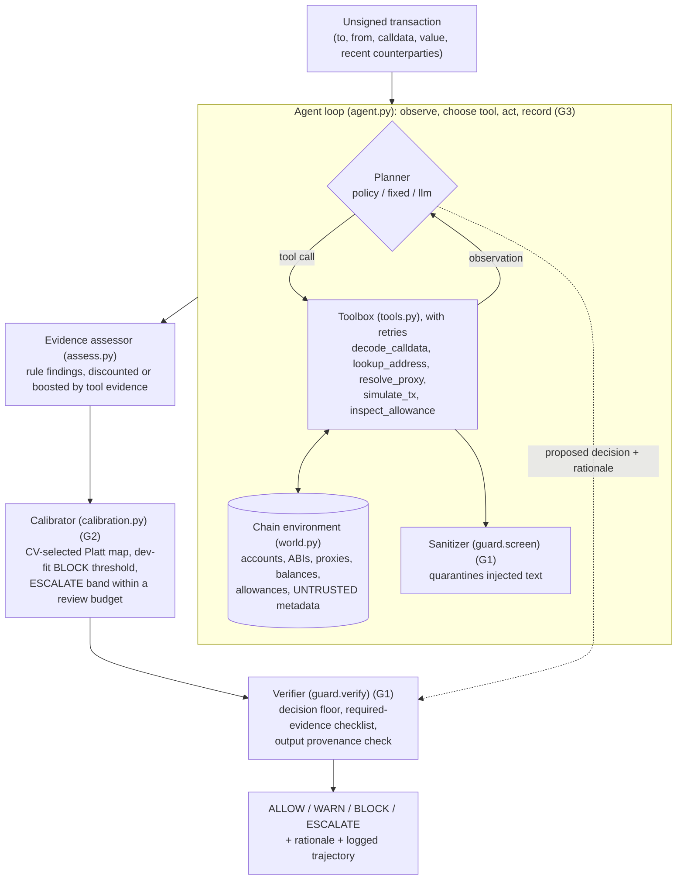

# GuardianTx

**An injection-resilient agent for risk-calibrated, pre-signing Ethereum
transaction defense.**

GuardianTx inspects an Ethereum transaction *before* a user signs it. It
investigates what the transaction will actually do: it decodes the calldata,
checks who the counterparties are, follows proxies, and simulates the call. It
then returns a risk decision, **ALLOW / WARN / BLOCK / ESCALATE**, with a
rationale. The targets are wallet-drainer patterns: unlimited and full-balance
approvals, NFT operator approvals, gasless permits, fake "claim" contracts,
malicious proxy upgrades, and address poisoning.

> Course: AI4015 Agentic AI, Semester Project Phase 2.
> Base paper: Ruaro et al., *Approve Once, Regret Forever: On the Exploitation of
> Ethereum's Approve-TransferFrom Ecosystem* (USENIX Security 2025), whose system is Osprey.

## Architecture



| Gap | Component (switchable for ablation) | Switch |
|---|---|---|
| **G1** injection resilience | `guard.py`: sanitizer (`screen`), verifier (`verify`, `echoes_untrusted`) | `AgentConfig(sanitize=, verify=)` |
| **G2** calibration and abstention | `calibration.py`: `Calibrator.fit` on dev; `Calibrator.identity()` = Phase-1 bands | `AgentConfig(calibrator=)` |
| **G3** dynamic investigation | `agent.py`: `PolicyPlanner` (data-dependent), vs. `FixedPlanner` | `AgentConfig(planner="policy" \| "fixed" \| "llm")` |

Robustness: every tool call is retried (default 2 retries), failures are logged,
and missing required evidence forces ESCALATE rather than ALLOW. E6 measures this
under injected tool faults. More detail is in [docs/ARCHITECTURE.md](docs/ARCHITECTURE.md).

## Installation

```bash
git clone <repo> && cd guardiantx
python --version            # 3.10+ (developed on 3.14)
pip install -r requirements.txt   # optional extras only; the offline system needs no packages
cp .env.example .env              # then set CEREBRAS_API_KEY / NVIDIA_API_KEY / GROQ_API_KEY (only needed for the LLM planner)
```

The offline system (policy planner, all experiments) uses only the Python
standard library.

## Configuration

| Variable | Used by | Default |
|---|---|---|
| `NVIDIA_API_KEY` | NVIDIA NIM provider for `--planner llm`, `--explain` | unset |
| `CEREBRAS_API_KEY` | Cerebras provider (the one used for the reported LLM run) | unset |
| `GROQ_API_KEY` | Groq provider, used as a further fallback | unset |
| `GUARDIANTX_PROVIDERS` | provider fallback order | `nim,cerebras,groq` |
| `NIM_BASE_URL` / `CEREBRAS_BASE_URL` / `GROQ_BASE_URL` | endpoints | `https://integrate.api.nvidia.com/v1` / `https://api.cerebras.ai/v1` / `https://api.groq.com/openai/v1` |
| `GUARDIANTX_MODEL` / `CEREBRAS_MODEL` / `GROQ_MODEL` | model per provider (needs function calling) | `nvidia/nemotron-3-ultra-550b-a55b` / `gpt-oss-120b` / `openai/gpt-oss-120b` |
| `GUARDIANTX_TEMPERATURE` / `GUARDIANTX_TOP_P` / `GUARDIANTX_SEED` | LLM decoding settings (recorded in every trace) | `0.2` / `0.7` / unset |
| `GUARDIANTX_PRICE_IN` / `_OUT` | USD per 1M tokens, for E6 cost | `0` |
| `GUARDIANTX_RPC_URL` | Phase-1 `--simulate` against a real anvil/RPC (needs `web3`) | unset |

Experiment settings (seed, review budget, false-block budget, fault rates) are in
[experiments/config.json](experiments/config.json). The LLM layer calls OpenAI-compatible APIs with
the standard library (no SDK), trying each provider in `GUARDIANTX_PROVIDERS` order
(default NIM → Cerebras → Groq). Each request is counted per provider in the trace
(`usage.providers`, `usage.fallback_calls`), because a fallback changes the model mid-run.
Report that share alongside any LLM result. On free tiers an LLM run takes
about 1 min per tx under rate-limit backoff, so `--sample N` evaluates a fixed, seeded, stratified subset of
the test split (and the first N test injection cases). The same N always selects the
same transactions. LLM runs are stochastic,
so they are repeated (3×) and reported as mean ± std.

## Running

```bash
# the agent on one transaction, with its trajectory
python -m guardiantx.cli --file examples/heldout_proxy_drain.json --agent --trace
python -m guardiantx.cli --file examples/heldout_proxy_drain.json --agent --json   # report + full trace
python -m guardiantx.cli --file examples/heldout_proxy_drain.json --agent --planner llm   # LLM planner (NVIDIA NIM)

# the Phase-1 baseline (unchanged)
python -m guardiantx.cli --file examples/unlimited_approve.json
```

Exit code: 0 = ALLOW/WARN, 2 = BLOCK/ESCALATE.

## Reproducing the experiments

```bash
python data/build_corpus.py                 # world.json, corpus.jsonl, splits.json, injections.jsonl (seed 2026)
python experiments/run.py all               # E1-E6, offline, about 10 s; writes results/ and logs/
python experiments/run.py e3 e4 e6 --planner llm --runs 3 --sample 40   # LLM planner (NIM, Groq fallback), stratified test subset
python tests/test_agent.py && python tests/test_decoder.py && python tests/test_rules.py && python tests/test_pipeline.py
```

| Exp. | What | Output |
|---|---|---|
| E1 | Phase-1 rules baseline | `results/e1_baseline.json` |
| E2 | Base paper (Osprey ACT detection, oracle re-implementation) | `results/e2_base_paper.json` |
| E3 | Full agent | `results/e3_proposed_policy.json`, `logs/e3_policy_test_traces.jsonl` |
| E4 | G1 / G2 / G3 experiments | `results/e4_gaps_policy.json`, `logs/e4_g1_injection_traces_policy.jsonl` |
| E5 | Ablation (one component removed at a time) | `results/e5_ablation.csv` / `.json` |
| E6 | Efficiency and reliability under tool faults | `results/e6_efficiency_policy.json` |
| — | Failure analysis and representative trajectories | `results/failure_analysis_policy.json` |
| — | Gap-resolution table | `results/gap_table_policy.md` |

**Protocol.** There is one fixed split: dev has 144 tx and test has 261.
Calibration, thresholds and guard patterns were fit on dev only. Three attack
types never appear in dev (`proxy_upgrade_drain`, `poisoned_spender_approval`,
`multicall_proxy_drain`; 45 test tx). Injection payloads use disjoint templates for
dev (45 cases) and test (75 cases). The policy planner is deterministic, so its
runs have zero variance. The 95% CIs below are bootstrap intervals over the test
set, and E6 fault runs use 3 seeds.

## Results (test split, policy planner)

| System | Accuracy | Precision | Recall | F1 (95% CI) | False-block rate | Held-out F1 |
|---|---|---|---|---|---|---|
| E1 Phase-1 rules baseline | 0.559 | 0.616 | 0.489 | 0.545 (0.463–0.617) | 25.8% | 0.500 |
| E2 Osprey ACT detection (oracle re-impl.) | 0.789 | 0.978 | 0.624 | 0.762 | 1.7% | 1.000 |
| **E3 GuardianTx agent** | **0.962** | 0.940 | **0.993** | **0.966 (0.942–0.986)** | **0.0%** | **1.000** |

A transaction counts as flagged when the decision is BLOCK or ESCALATE.
False-block rate is the share of benign tx that get a hard BLOCK. The agent sends
5.7% of all test tx to a human (ESCALATE). These escalations are why its precision
is below 1.0.

**E5 ablation** ([results/e5_ablation.csv](results/e5_ablation.csv)):

| Configuration | F1 | Recall | Escalation | ECE | Worst-case injection ASR | Tool calls |
|---|---|---|---|---|---|---|
| Full system | 0.966 | 0.993 | 5.7% | 0.081 | 0.0% | 3.44 |
| − sanitizer (G1) | 0.966 | 0.993 | 5.7% | 0.081 | 0.0% | 3.44 |
| − verifier (G1) | 0.966 | 0.993 | 5.7% | 0.081 | 72.0% | 3.44 |
| − calibration / abstention (G2) | 0.975 | 0.950 | 0.0% | 0.081 | 0.0% | 3.44 |
| − simulation | 0.966 | 0.993 | 5.7% | 0.121 | 0.0% | 3.28 |
| fixed tool order (G3) | 0.940 | 0.993 | 8.8% | 0.082 | 0.0% | 4.94 |

**E6:** the dynamic planner averages 3.44 tool calls per tx against 4.94 for fixed
order. Under a 30% transient tool-failure rate, F1 is 0.948 ± 0.004 with retries
and 0.798 ± 0.003 without; decision agreement with the fault-free run is 96.6% vs
63.7%.

**E3 with an LLM planner (Cerebras `gpt-oss-120b`, temp 0.2, top_p 0.7, 3 runs × a
seeded stratified sample of n=12 test tx, mean ± std):** F1 0.838 ± 0.033,
recall 1.000 ± 0.000, precision 0.722 ± 0.048, false-block 0.056 ± 0.096,
ECE 0.091 ± 0.021, 4.25 ± 0.33 tool calls/tx; held-out slice (n=1) F1 1.000 ± 0.000.
Recall was 1.000 in every run (no malicious tx missed); one of the three runs
hard-blocked a benign tx once, which is the source of the non-zero false-block mean.
All runs completed with no hard rate-limit failures. This is a small-sample result —
the deterministic PolicyPlanner above is the system of record; the LLM planner is
reported to show the loop runs end to end against a live model and is stable across
runs. `results/e3_proposed_llm.json`.

## Gap-resolution table

| Gap | Method / component | Metric | Base paper result | Our result | Addressed? |
|---|---|---|---|---|---|
| G1 Injection resilience | `guard.py` sanitizer + verifier (decision floor, evidence checklist, output provenance) | Attack success rate (ASR), worst-case reasoner, 70 eligible test injections (no defense → full guard); clean-F1 change | No reasoning layer, so no injection surface and no defense (not applicable) | ASR 90.7% → 0.0%; F1 change +0.0 pts | Fully* |
| G2 Calibration & abstention | `calibration.py` CV-selected Platt scaling, dev-fit thresholds, ESCALATE band | Test ECE, false-block rate, recall, selective accuracy (uncalibrated → calibrated) | ECE 0.211, FBR 1.7%, no confidence or abstention (binary output, oracle re-impl.) | Agent (identity map): ECE 0.081 → 0.081, FBR 0.0% → 0.0%, recall 0.950 → 0.993, selective acc. 0.973 → 0.996 at 94.3% coverage; Phase-1 scorer ECE 0.344 → 0.103 | Partially |
| G3 Dynamic investigation | `agent.py` PolicyPlanner (data-dependent tool selection) | F1 on held-out unseen attack types (n=45) | F1 1.000 (oracle re-impl.); Phase-1 baseline F1 0.500 | F1 1.000 (fixed order 1.000); on all test, F1 0.966 vs 0.940 for fixed order, with 3.44 vs 4.94 tool calls | Partially |

\* G1 depends on the verifier: with the decision floor, "downgrade" attacks fail by
construction against a fully hijacked reasoner. The regex sanitizer alone
generalises poorly: it catches 100% of dev payloads but only 20% of test payloads.
The ASR/F1 figures above use the worst-case compliant reasoner; the live LLM-planner
E3 run (Cerebras `gpt-oss-120b`, 3×n=12) is reported in the E3 note above.

Generated by `experiments/run.py` into `results/gap_table_policy.md`. Read the
"Base paper" column with care: Osprey cannot be run on this environment, so E2
gives it oracle access to ground-truth ACT labels. Its numbers are therefore an
upper bound for contract-side detection, not numbers taken from the paper.

## Changes since Phase 1

| Change | Reason |
|---|---|
| Corpus grew from 24 to 405 tx over a simulated chain environment (`data/world.json`), replacing Anvil | Foundry/Anvil is not available in the evaluation environment, and a deterministic world makes every result reproducible offline. The Phase-1 RPC simulator path is kept. |
| Fixed dev/test split, with 3 held-out attack types | Required for G3 and for tuning without touching test |
| Injection set: 120 cases (5 categories × 24) with disjoint dev/test templates | As proposed; disjoint templates measure generalisation |
| G1 defense is sanitizer **plus verifier** (Phase 1 had the sanitizer only) | The dev/test experiment showed the sanitizer does not generalise (devlog iterations 1 and 3) |
| G1 is evaluated with a worst-case compliant reasoner as well as the LLM planner | Gives an upper bound that runs without API access |
| Base-paper comparison uses an oracle re-implementation of Osprey's ACT detection | Osprey needs contract bytecode, which the environment does not have |
| LLM-planner runs use **Cerebras `gpt-oss-120b`** (fallback order NIM → Cerebras → Groq), not Anthropic Claude as proposed | Group decision on free-tier API access; NVIDIA NIM's 550B model was ~1 min/tx and Groq hit a per-model daily token wall, so the reported E3 LLM run was served by Cerebras. All are OpenAI-compatible and the model is configurable. |
| Package stays in `guardiantx/` rather than `src/` | Keeps Phase-1 imports and commands working |

The iteration history is in [docs/devlog.md](docs/devlog.md).

## Layout

```
<<<<<<< HEAD
guardiantx/   agent.py (loop, planners), tools.py, world.py, assess.py, guard.py (G1),
              calibration.py (G2), metrics.py, baselines.py (E2), llm.py, cli.py,
              plus Phase-1: contracts, decoder, signatures, encoding, rules, pipeline, simulator
data/         build_corpus.py → world.json, corpus.jsonl, splits.json, injections.jsonl; Phase-1 seed set
experiments/  run.py (E1–E6), config.json
results/      all reported numbers (json/csv/md)
logs/         agent trajectories (E3 full test set, E4 injection sample)
tests/        decoder, rules, pipeline, agent/guard/calibration/world tests
docs/         ARCHITECTURE.md, devlog.md, Phase-1 deliverables
eval/         Phase-1 evaluation harness
```

## Limitations (short)

The corpus and the world are synthetic and generated by the same authors who wrote
the assessor's heuristics. That makes the agent's high scores optimistic. The
results show the system works under controlled conditions, not on real mainnet
traffic. The simulator models ERC-20/721 semantics and drainer sweeps, not the EVM.
Trusted reputation fields (verification, scam lists) are assumed correct.
=======
guardiantx/      core package (contracts, decoder, signatures, simulator, rules, pipeline, llm, cli)
data/            dataset builder + generated seed set
eval/            evaluation harness (metrics, confusion matrix, per-category)
tests/           decoder / rules / pipeline tests
docs/            architecture, literature review, proposal
docs/phase1/     Phase 1 report source + PDF build script
```

## Phase 1 report

The submitted PDF (Deliverable A + B) is built from
[docs/phase1/Phase1_source.html](docs/phase1/Phase1_source.html) with headless Chrome:

```bash
docs/phase1/build.sh --preview   # draft, shows unfinished sections
docs/phase1/build.sh             # final: Phase1_GuardianTx_22I-0794.pdf
```

The final build stops and lists what is left if any section is unwritten or
any cited figure is still flagged for verification.

## Roadmap to the proposed system (Phase 2+)

- LLM agent that *dynamically* chooses tools to investigate a transaction
- Prompt-injection taxonomy + resilience eval over untrusted on-chain data
- Calibrated confidence (ECE, Brier, risk–coverage) and principled abstention
- Expand the corpus toward ~400 tx with held-out unseen attack types

## Team

| Member | Roll no. | Responsibilities |
|---|---|---|
| Syed Kalbe Raza (group head) | 22I-0794 | Agent orchestration and tools (G3); calibration and evaluation (G2) |
| Shayan Ahmed | 22I-0822 | Injection taxonomy and resilience layer (G1); dataset and literature review |
>>>>>>> aee3143f8d7104a13806f479e7b46e366fa01f59
