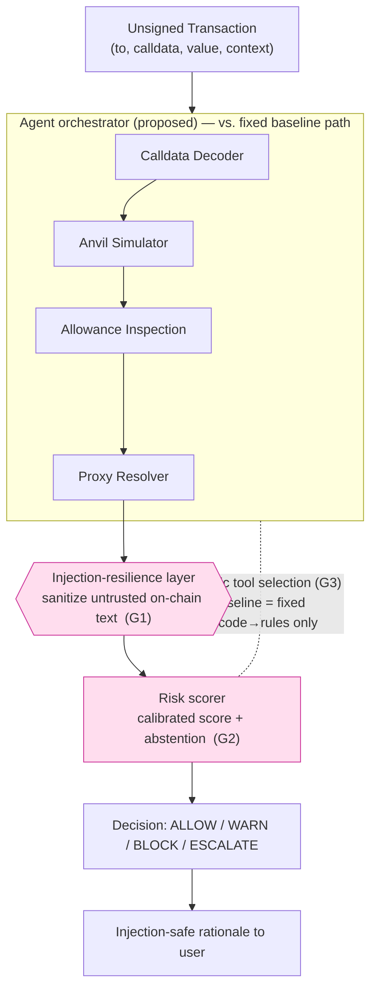

# Deliverable B — Project Proposal

> **Note on use.** Complete draft written as original synthesis from the system
> you built and the reviewed literature. Rewrite in your own voice before
> submitting (the rubric bars AI-generated text). Items only you can supply are
> marked `[FILL]`.

**Project code:** `[FILL: e.g. G1-xx]`  **Title:** **GuardianTx — An
Injection-Resilient Agent for Risk-Calibrated Pre-Signing Blockchain Transaction
Defense**  **Selected seed:** approved own idea.

**Group members:** `[FILL: names + roll numbers]`

---

## 1. Problem statement and motivation

Every interaction with a decentralised application on Ethereum ends with the user
signing a transaction. That signature is the point of no return: once signed and
broadcast, a transaction cannot be recalled. Yet the object a user signs is
effectively unreadable — a target address and a blob of hexadecimal calldata — so
users approve actions whose true effect they cannot see. Attackers exploit exactly
this gap. A single `approve` or `permit` can grant an attacker unlimited authority
over a token balance; a single `setApprovalForAll` can hand over an entire NFT
collection; a copied look-alike address can divert a transfer to a thief. These are
not edge cases: the approve-transferFrom pattern studied in our base paper is tied
to over $65M in losses, Drainer-as-a-Service operations have drained roughly $135M
from more than 76,000 victims, and address-poisoning campaigns account for hundreds
of millions of on-chain attack attempts.

The users who bear this risk are ordinary wallet holders, and the natural
integration point is the wallet or browser extension that mediates signing.
Existing defenses do not serve them at the decisive moment. Contract-side analyses
such as our base paper's Osprey find vulnerable contracts offline, for developers
and auditors, not for a user about to sign. Measurement studies characterise the
threat but build no defense. Rule-based phishing detectors are brittle to new
patterns and offer no notion of confidence. The one closely comparable pre-signing
LLM tool, DeepTx, is not evaluated for resilience against prompt injection, is not
calibrated, and runs a fixed analysis pipeline. The problem matters because the
harm is irreversible and large-scale, and because the defense has to live precisely
where no adequate defense currently exists: on the user side, before signing, and
robust against adversarial data.

## 2. Base paper and the three research gaps

Our base paper is Ruaro et al., *Approve Once, Regret Forever* (USENIX Security
2025, CORE A\*), whose system Osprey detects contracts vulnerable to the ACT
(Approved Controllable TransferFrom) pattern and generates proof-of-concept
exploits, but operates offline and contract-side. From the wider review we draw
three gaps (detailed in Deliverable A §4):

- **G1 —** no pre-signing, **injection-resilient** defense for the human signer;
- **G2 —** detectors report accuracy but are **not calibrated** and never **abstain**;
- **G3 —** no agent that **dynamically** investigates the full pre-signing context
  (decode + simulate + allowance + proxy).

GuardianTx goes beyond the base paper by moving defense to the user/pre-signing
side, adding dynamic multi-tool investigation, producing a calibrated risk score
with an explicit escalation band, and hardening the reasoning layer against
injection.

## 3. Target product / system

The end-of-semester system is a pre-signing transaction guard that a wallet calls
with an unsigned transaction and receives back a decision — **ALLOW / WARN / BLOCK
/ ESCALATE** — together with a human-readable, injection-safe rationale. It is
delivered as a Python library and command-line tool (the non-agentic baseline is
already built, Deliverable C) plus the LLM agent layered on top, accompanied by a
reproducible evaluation harness and sanitized, safe-to-release datasets.

## 4. Agentic justification

The problem genuinely requires agentic behaviour rather than a single LLM call, a
deterministic script, or a retrieval pipeline, for four reasons. First, the control
flow is **data-dependent**: what to examine next depends on what earlier steps
reveal — an unrecognised selector should trigger proxy resolution, which yields an
implementation address that must be re-decoded and then simulated. A fixed pipeline
(as in DeepTx or rule-based detectors) cannot branch this way. Second, the task is
**multi-step and stateful**: the system accumulates findings across decoding,
simulation, allowance inspection, and proxy resolution before it can decide, so it
needs working state, not a single prompt. Third, it is fundamentally about **tool
use over a live environment** — decoding calldata, simulating against a local fork,
reading allowances, resolving proxies — which is action, not the document retrieval
that RAG provides. Fourth, the inputs are **adversarial**: untrusted on-chain
strings can attack the reasoner itself, and ASB shows LLM agents reaching ~84%
attack success, so the design must treat injection resilience as a first-class
concern that a naive single call cannot. By contrast, a single LLM call has no
tools or branching, a deterministic rule set (our baseline) cannot adapt to unseen
patterns, and RAG retrieves context rather than taking the investigative actions the
task demands.

## 5. Goals and success criteria

**Development objectives:** (a) a pre-signing agent that orchestrates four tools;
(b) an injection-resilience layer over untrusted on-chain data; (c) a calibrated
risk score with a principled abstention band; (d) an evaluation harness and
datasets. **Measurable research objectives** (at least one success criterion per
gap):

| Gap | Success criterion (target) |
|---|---|
| G1 | Agent keeps detection **F1 ≥ baseline** while holding injection **attack-success-rate < 10%** across the 120-case taxonomy. |
| G2 | **ECE reduced vs. the uncalibrated scorer**, with a risk–coverage operating point that keeps **false-block rate < 5%** on benign tx. |
| G3 | Agent **beats the non-agentic baseline F1** on **held-out unseen attack types**, at acceptable tool-call cost/latency. |

## 6. Data / environment / source (confirmed)

- **Environment:** a local **Foundry/Anvil** fork — no real funds, no mainnet
  writes.
- **Transaction corpus:** approximately **400** benign and malicious transactions
  built from documented drainer patterns (approval phishing, NFT operator
  approvals, suspicious proxy interactions, address poisoning). A **seed of 24 is
  already in the repository** (`data/seed_transactions.jsonl`, reproducible via
  `data/build_seed.py`); we expand toward 400, holding out **unseen attack types
  and contract variants** for final evaluation.
- **Injection taxonomy:** **120** test cases across five categories — authority
  spoofing, instruction override, tool-output laundering, role/reasoning spoofing,
  and multilingual/encoded injection.
- **Release:** sanitized datasets and safe evaluation artifacts only; no directly
  deployable malicious contracts.

## 7. System architecture

(Full description in [ARCHITECTURE.md](ARCHITECTURE.md); diagram in §8.) The
**models/provider** layer uses Anthropic Claude, wired through `guardiantx/llm.py`,
while the baseline requires no model. The **tools** are a calldata decoder, an
Anvil-backed simulator, allowance inspection, and a proxy resolver. **State and
context** flow as structured contracts — `Transaction → DecodedCall → Finding[] →
RiskReport` (`guardiantx/contracts.py`) — all JSON-serializable. For
**orchestration**, the baseline runs a fixed decode-then-rules path, whereas the
proposed agent runs a loop that selects tools until it is confident and then scores.
**Human controls** are the four decisions ALLOW/WARN/BLOCK/ESCALATE, where ESCALATE
routes to human review. **Injection defense** sanitizes untrusted on-chain text at
the tool-to-LLM boundary (`guardiantx/llm.sanitize`).

## 8. Methodology / architecture diagram

The baseline differs by running **only** Decoder → rules → score, with no
simulation, no dynamic tool selection, and no LLM. The three gaps are marked
**G1/G2/G3** at the components that address them.

## 9. Baseline(s)

1. **Non-agentic rules baseline** — already built (Deliverable C): calldata
   decoding plus heuristics combined with a noisy-OR score. Initial results on the
   24-transaction seed set are **accuracy 0.875, precision 1.00, recall 0.75,
   F1 0.857, false-block rate 0.00**.
2. **Base paper (Osprey)** — the contract-side ACT detector, used as the external
   comparison point for the approve/transferFrom surface.
3. *(Optional)* a single-LLM-call classifier, to isolate the agent's lift over a
   naive LLM.

## 10. Research questions and hypotheses

- **G1 — RQ:** Does a sanitization boundary preserve detection quality while
  resisting injection? **Hypothesis:** injection attack-success-rate falls below
  10% with at most one F1 point lost.
- **G2 — RQ:** Does calibrated scoring with abstention lower false blocks at a
  fixed recall? **Hypothesis:** ECE and false-block rate both fall relative to the
  uncalibrated baseline at equal recall.
- **G3 — RQ:** Does dynamic tool use beat the fixed baseline on unseen attacks?
  **Hypothesis:** the agent's F1 on held-out attack types exceeds the baseline's.

## 11. Evaluation plan

The **evaluation set** is a held-out split of the 400-transaction corpus (unseen
types and variants) plus the 120 injection cases. **Detection metrics** are
precision, recall, F1, accuracy, and the confusion matrix (harness already built,
`eval/evaluate.py`). **Calibration metrics** are expected calibration error, Brier
score, risk–coverage curves, and false-block rate. The **injection metric** is
attack-success-rate per taxonomy category. **System measures** are tool-call count
and efficiency, latency, and API cost. **Comparisons** run the agent against the
rules baseline, the base paper, and the single-LLM classifier. **Ablations** remove
simulation, remove sanitization, remove calibration, and fix the tool order, to
isolate each component's contribution.

## 12. Milestones, feasibility, risks, and work division

**Milestones:** (M1) baseline and seed data — done; (M2) expand the corpus to 400
and author the 120 injection cases; (M3) build the agent loop and four tools;
(M4) add the injection-resilience layer and calibration; (M5) run the full
evaluation with ablations; (M6) write up results. **Technical risks and
fallbacks:** Anvil/RPC flakiness is mitigated because the simulator already
degrades gracefully to static analysis; LLM cost and latency are controlled by
caching and capping tool calls, with the baseline path always available; dataset
labelling effort is reduced by starting from documented patterns and the seed
builder. **Work division** `[FILL: names/roll numbers]`:

| Member | Primary responsibility |
|---|---|
| `[FILL]` (head) | Agent orchestration + tools (G3) |
| `[FILL]` | Injection taxonomy + resilience layer (G1) |
| `[FILL]` | Calibration + evaluation harness (G2) |
| `[FILL]` | Dataset construction + literature-review upkeep |

All members remain responsible for understanding the complete project.

## 13. Potential publication direction

If the results hold, the novel contribution is the first **injection-resilient,
risk-calibrated, dynamically-investigating pre-signing transaction guard**,
accompanied by a reusable benchmark pairing a labelled transaction corpus with a
prompt-injection taxonomy for the blockchain setting. A strong outcome would suit a
security or software-engineering tool/workshop venue; the benchmark itself may be a
separate contribution of lasting use to the community.
